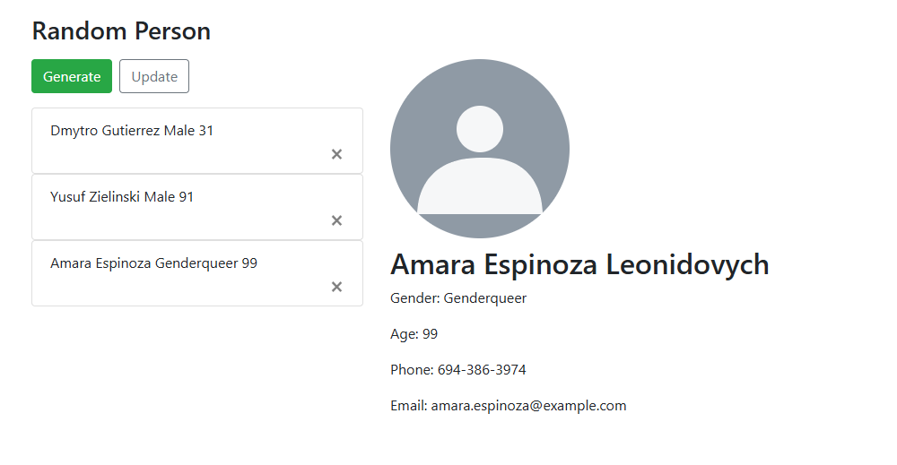
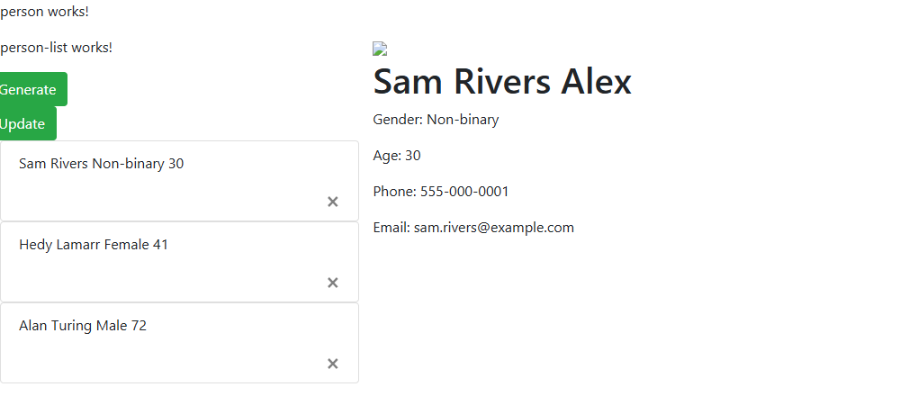

# Random Person

**[▶ Live demo](https://dimitriuses.github.io/Random-Person/)**

[](https://github.com/Dimitriuses/Random-Person/actions/workflows/pages.yml)


A two-panel Angular app that invents people. Press **Generate** to add a random
person to the list on the left; click one to see their details on the right;
press **×** to remove them. Written in October 2019 while learning Angular
component communication — `@Input`, `@Output`, `EventEmitter` and a shared
service — and kept as a record of that.



## Status and history

**Five commits of real work, over three days: 22–24 October 2019.** The other 18
of the repository's 23 commits are Dependabot bumps and their merges. It is a
learning exercise, not a product, and it is archived rather than maintained.

It runs. Verified on Node 22.20 in July 2026: `npm ci` installs from the
committed lockfile with no native rebuild, `ng lint` is clean, `ng serve`
compiles and answers, and `ng build --prod` produces the site linked above.

Two things about that are worth stating separately, because they are not the same
claim:

- **`ng serve` worked in 2019 and still works.** The 2026 half is measured. The
  2019 half is an inference — from the commit messages (`components is works`,
  `generator and design works`, `detals and delete complete`) and from later
  commits editing markup the earlier ones introduced.
- **`ng build --prod` has never worked, and that is measured at both ends.**
  Checked out at `v0.1-original`, a production build fails with three errors.
  See below.

## What changed in 2026

A tidy, not a rewrite: no component was restructured and no feature was added.
Six things were fixed, and every one of them had to be fixed for the demo above
to exist at all.

### The production build had never succeeded

```
ERROR in src/app/person/person.component.html(8,65): Property 'activePerson' does not exist on type 'PersonComponent'.
          src/app/person/person.component.html(8,28): Property 'activePerson' does not exist on type 'PersonComponent'.
          src/app/person/person.component.html(5,26): Property 'activePerson' does not exist on type 'PersonComponent'.
```

`person.component.html` assigns to `activePerson` from the list's output and
reads it back in an `*ngIf`, but `PersonComponent` never declared the property.
`angular.json` sets `"aot": false` for the development build and `"aot": true`
for production, while `tsconfig.json` sets `"fullTemplateTypeCheck": true` — so
the JIT path never type-checked the template and simply created the property on
the instance at runtime, and the AOT path rejects it.

The consequence is the interesting part: **`ng serve` worked perfectly, so
nothing ever surfaced the error.** A project can pass every check its author
actually runs and still have no deployable build. Declaring one property fixes
it, and that is why this repository had no demo for seven years.

### A live API key was public for seven years

`person.service.ts` fetched each person from a Mockaroo endpoint with the
account's API key in the query string. **The key still returned live data when it
was tested in 2026.** It has been revoked and removed from the source.

It remains in `git log` and in the `v0.1-original` tag, deliberately: revoking
the key at the source is the fix, and rewriting five-year-old commits would not
have undone seven years of public exposure.

**The remote endpoint is gone rather than disabled, and the app deliberately
offers no way to point back at it.** The 2019 URL referenced a *saved schema* on
that account, so even with a valid key a reader would have to recreate the schema
— seven fields, one of them misspelled, and the exact eight-value gender list —
before one button worked. A "paste your API key here" field would ask that of
every visitor and would put a live third-party credential into a client-side
bundle to do it. `PersonService` generates the same seven fields locally instead,
with the same eight gender values and the same 1–100 age range, so the shape the
components consume is unchanged. The original schema is documented in
[`docs/ASSETS.md`](docs/ASSETS.md) for anyone who wants the historical contract.

### Roughly a quarter of generated people had no picture

The avatar was chosen by a chain of `if`s on `gender` and age:

```ts
if (json.gender == "Male") {
  if (json.year < 20) { … } else if (json.year < 50) { … } else if (json.year < 100) { … }
}
if (json.gender == "Female") { … }
```

Three gaps, all measured against the real endpoint before it was retired, over
one 200-row sample:

| Gap | Rows affected |
|---|---|
| The schema emitted **eight** gender values, not two — also `Non-binary`, `Agender`, `Genderqueer`, `Bigender`, `Polygender`, `Genderfluid` | **18 / 200** |
| The age range reached 100 inclusive, but the last test is `< 100` | **3 / 200** |
| Two of the six hardcoded image URLs had gone dead (403 and 404) | **33 / 200** |

Anyone matching no branch got `undefined`, which Angular renders as
``. Total: **54 of 200 people — 27% — showed a broken image.**

The same scenario in both versions, a person whose gender is outside
`{Male, Female}` selected in the detail panel:

| 2019 | 2026 |
|---|---|
|  |  |

Avatar selection is now a pure function with a total mapping, and the six
hotlinks are seven local SVGs. Measured over 60 generated people on the built
site: **0 with a missing or undecodable image**, against 4 of 8 across the
buckets above.

### Generate appeared to do nothing

`generatePerson()` was `async` and awaited a `fetch`; its caller did not await
it, and `getAllPersons()` returns a **copy** of the array — so the list was
always re-read before the new person existed. Measured on the 2019 build: **four
seconds after clicking Generate, the list still held 0 items.** The commented-out
`//this.Update();` in `onGenerate` is the attempt at fixing it, and the manual
**Update** button beside **Generate** is the workaround that shipped instead.

The generator is now synchronous, so `Generate` refreshes the list itself. The
`Update` button is still there — it is part of the 2019 UI and it still works —
but it is no longer load-bearing.

### The UI still had its scaffolding text in it

`<p>person works!</p>` and `<p>person-list works!</p>`, straight out of
`ng generate component`, were visible in the running app. Both removed.

### Content was clipped off the left edge of the window

There was no Bootstrap `.container` anywhere, so `.row`'s `margin: 0 -15px` had
nothing to absorb it. Measured: the **Generate** button's left edge sat at
`x = -15`, and the page carried **15 px of horizontal overflow**. Now 0 px, at
desktop width and at a 390 px phone width.

While in there: `col-xs-12` (8 uses) and `img-responsive` (1 use) are
**Bootstrap 3** class names in a Bootstrap 4 project. Measured against the built
stylesheet, both matched **0 CSS rules** — they had never done anything.
Replaced with `col-12` and `img-fluid`.

### And, without changing behaviour

- Dropped four dependencies that nothing imported: `@angular/animations`,
  `@angular/forms`, `@angular/router` (there is no router in this app) and
  `ngx-bootstrap`, whose `AlertModule.forRoot()` sat in `AppModule` while no
  template used an alert. Verified surgical: **1059 → 1055** resolved
  `name@version` entries — the 4 intended removals, **0 additions, 0 version
  changes**.
- **166 lint errors → 0**, all of them formatting and `==` vs `===`.
- Removed the commented-out code: a 22-line dead copy of the avatar chain in
  `person-detail.component.ts`, a dead `<ul>` in the list template, and nine
  `//console.log` lines.
- Renamed two misleading identifiers: `faterName` → `fatherName`, and `year` →
  `age` (it always held an age, and the template already labelled it "Age").
  Casing brought in line with the rest — `DeletePerson` → `deletePerson`,
  `Persons` → `persons`.
- Added `.nvmrc`, `.npmrc` (see below), `LICENSE`, this README, the Pages
  workflow and the screenshots.

## Running it

Needs Node 22 — `nvm use` reads `.nvmrc`.

```bash
npm ci
NODE_OPTIONS=--openssl-legacy-provider npm start      # http://localhost:4200
NODE_OPTIONS=--openssl-legacy-provider npx ng build --prod
```

**Why the environment variable.** Angular CLI 8 runs on webpack 4, which asks
OpenSSL for md4, and OpenSSL 3 (Node 17+) removed it from the default provider —
without this the build dies with `ERR_OSSL_EVP_UNSUPPORTED`. That is the *only*
toolchain change needed to build this on a current Node. In particular there is
no `node-sass` to rebuild, because Angular CLI 8.3 already shipped dart-sass
(`sass@1.22.9` is right there in the 2019 lockfile). Nothing was retargeted.

`.npmrc` sets `legacy-peer-deps=true`. Regenerating the lockfile to drop the four
unused dependencies produced a v3 lockfile, and npm 7+ then demanded Bootstrap
4's `jquery`/`popper.js` peers that the original npm-6 lockfile never recorded.

`ng build` on its own — the development configuration — fails on modern Node in
the ES5 differential-loading step (`SourceMapConsumer.initialize`). Pass
`--source-map=false`, or just use `--prod`, which sets it already.

## Tests

**None of them pass, and none ever did.** `ng test` reports
`Executed 7 of 7 (7 FAILED)` — identically at `v0.1-original` and today. Three
causes, all in CLI-generated specs that were never updated after the templates
they test were replaced:

- Each spec declares only its own component, so every child element is unknown:
  `'app-person-list' is not a known element`.
- `person-detail` and `person-item` call `detectChanges()` without setting their
  required `@Input`, so both throw `Cannot read properties of undefined`.
- `app.component.spec.ts` asserts on `.content span` containing
  `rand-person app is running!` — markup that has never existed in any committed
  version of this repository. `e2e/` carries the same stale assertion.

They are **left failing on purpose.** Writing a suite is outside what this pass
was for, and deleting the specs would hide the fact. CI lints, builds and deploys
rather than pretending otherwise.

## Layout

```
src/app/
  app.module.ts                     declares everything; provides PersonService
  model/person.ts                   the one domain type
  person/
    person.component.*              two-panel shell; owns the selected person
    person.service.ts               the generator and the avatar mapping
    person-list/
      person-list.component.*       Generate / Update; holds a snapshot copy
      person-item/                  one row; emits select and delete upward
    person-detail/                  read-only detail panel
src/assets/avatars/                 7 generated SVGs — see docs/ASSETS.md
tools/build-avatars.js              regenerates them
```

Communication is deliberately all `@Input`/`@Output` — no store, no router, and
`PersonService` is a plain class wrapping an array. That was the point of the
exercise.

## Known limitations

- **Names are drawn independently of gender**, so the generator will happily
  produce `Oksana … Male`. The replacement generator makes no attempt to
  correlate the two.
- **Bucketing an avatar by a gender string is a poor design**, and it is the 2019
  design, kept for fidelity. The 2026 change only made the mapping *total*; it did
  not question it. A better version would not branch on gender at all.
- **The list is a snapshot copy.** `getAllPersons()` returns `.slice()`, so the
  list component has to be told to re-read after every change — which is why an
  `Update` button exists in the first place.
- **`deletePerson` matches on all seven fields rather than on object identity**,
  and does not stop at the first match. Two identical people cannot both be
  deleted. Left as written in 2019.
- **No persistence, no routing, no forms.** Reloading the page loses everyone.
  The router package was removed because there were never any routes.
- **The list rows are not keyboard-reachable** — `<a>` elements with a click
  handler and no `href`.
- **`npm audit` reports 133 advisories, 3 of them outside `devDependencies`**
  (all three in Angular 8's own `common`/`compiler`/`core`). The remaining 130
  are webpack/karma/protractor build-time transitives that never reach a browser.
  Not fixed: upgrading Angular 8 is not a tidy, and the point of this repository
  is that it is a 2019 artifact.
- **Protractor is end-of-life** (2023). `e2e/` is left in place, stale.

## Licence

[MIT](LICENSE). The seven avatars in `src/assets/avatars/` are generated by
`tools/build-avatars.js` and covered by the same licence; see
[`docs/ASSETS.md`](docs/ASSETS.md) for what they replaced, and why they could not
stay.
